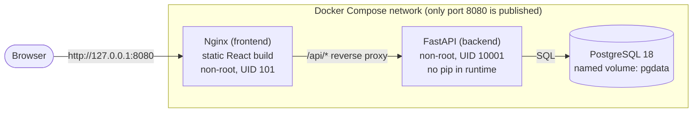
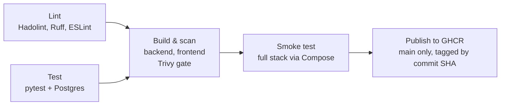

# Chapter 1: Containerize, harden and ship through a DevSecOps pipeline

**Objective:** take a three-tier web app from "runs on my machine" to small, non-root container images shipped through a CI pipeline that blocks fixable vulnerabilities before they reach `main`.

| | |
|---|---|
| **App** | Portfolio Hub: FastAPI + React + PostgreSQL |
| **Repo** | https://github.com/Dosky-lala/portfolio-hub |
| **Duration** | Oct 25 – Nov 12, 2026 (~2.5 weeks; budget was 1–2 weeks) |
| **Cost** | $0 (GitHub Actions and GHCR are free for public repositories) |
| **Status** | Complete: all Completion Gate items checked (GitOps N/A until Chapter 4) |

---

## Skills demonstrated

- **Containers:** multi-stage Dockerfiles, non-root numeric UIDs, minimal runtime images, layer caching, `.dockerignore`
- **Orchestration (local):** Docker Compose with healthchecks, `depends_on: service_healthy`, named volumes, internal-only networking
- **CI/CD:** GitHub Actions with parallel jobs, service containers, matrix builds, artifacts, "build once, ship what you scanned"
- **DevSecOps:** Trivy vulnerability gate, Hadolint, SHA-pinned actions, digest-pinned images, least-privilege tokens, Dependabot
- **Testing:** pytest against a real PostgreSQL, a destructive-test safety guard, Ruff and ESLint
- **Git and GitHub:** Conventional Commits, branch rulesets with required checks, PR workflow, `rebase --onto`, `push --force-with-lease`, GitHub CLI
- **Operations:** health endpoints that report dependency state, break-it drills, blameless postmortems, troubleshooting by evidence

## Prerequisites

- Windows with WSL2 (Ubuntu), or any Linux machine
- Docker Engine with Compose v2 (native in WSL, not Docker Desktop)
- Git with an SSH key on GitHub; GitHub CLI (`gh`)
- Python 3.14, Node 26 LTS (via `nvm`)
- Basic familiarity with the terminal, HTTP and SQL

---

## Architecture



**How the parts connect.** The browser only ever talks to Nginx on `127.0.0.1:8080`. Nginx serves the pre-built React files and forwards anything under `/api/` to FastAPI over the private Compose network, so the browser sees a single origin and no CORS configuration is needed. FastAPI talks to PostgreSQL on the same private network; neither the API port (8000) nor the database port (5432) is reachable from the host. PostgreSQL stores its data in a named volume, so it survives container restarts and `docker compose down`.

**Why `/api/health` checks the database.** It runs `SELECT 1` and returns **503** if that fails. A process can be running but useless; reporting dependency health lets Compose (and later Kubernetes) tell the difference.

---

## Step-by-step build, with the reasoning

### 1. Environment
Project files live in the Linux filesystem (`~/projects/`), not under `/mnt/c/`, for performance and correct permissions. A dedicated SSH key and the GitHub noreply email keep identity clean in a public history. Native Docker Engine in WSL avoids Docker Desktop's licensing and resource overhead.

### 2. Backend
FastAPI with SQLAlchemy 2. The completion gate is a PostgreSQL **JSONB** column (one key per gate item; `null` means "not applicable"). Partial updates merge into a **new** dict, because SQLAlchemy doesn't detect in-place changes to JSON columns. `DATABASE_URL` is read with `os.environ[...]`, so a missing setting fails at startup instead of at the first request.

### 3. Frontend
A single React (Vite) page. All API calls go through one helper that surfaces backend error messages. Data loads inside an effect with a stale-response guard, and every change triggers a reload from the server: the server is the source of truth.

### 4. Containerization
- **Backend:** two stages. The builder installs dependencies into a virtualenv; the runtime copies only that virtualenv and the app code, runs as UID 10001, removes `pip`, and applies Debian security updates.
- **Frontend:** a Node stage builds static files; the runtime is unprivileged Nginx serving only `dist/`, with Alpine security updates applied.
- **Result:** 611 MB to 100 MB across both images, with nothing running as root.

### 5. Compose
The database has a `pg_isready` healthcheck; the backend waits for it to be healthy and has its own healthcheck on `/api/health`. Only the frontend publishes a port, bound to `127.0.0.1`. Secrets come from a git-ignored `.env`.

---

## DevOps and GitOps implementation

### CI pipeline (GitHub Actions)



- Lint and test run in parallel; images are only built if both pass.
- Each image is built once, saved as an artifact, scanned, smoke-tested, and **that exact file** is published, tagged with the commit SHA.
- **Gate policy:** fail on fixable HIGH/CRITICAL vulnerabilities only. Gating on unfixable findings produces a permanently red pipeline that people learn to ignore.
- Read-only token by default; only the publish job can write packages.

### Supply chain
- Actions pinned to full commit SHAs, resolved and verified with `git ls-remote`.
- Base images and CI tool images pinned by multi-architecture digest.
- **Extension ("make it mine"): Dependabot** for actions, pip, npm and base images, with major runtime upgrades excluded so they remain deliberate decisions. Verified end to end by deliberately downgrading pytest and watching Dependabot open a tested PR.
- One version file per runtime (`.nvmrc`, `.python-version`), read by both the laptop and CI.

### Branch protection
A `protect-main` ruleset requires a pull request and five passing checks, and blocks force pushes and deletion.

### GitOps
Not applicable in this chapter. Commit-SHA image tags and a protected `main` are the groundwork for Argo CD in Chapter 4.

### Break-it drill
A change relaxing validation (`chapter >= 1` to `>= 0`) was pushed on a branch. The test suite caught it within ~30 seconds of the test job starting, and the ruleset blocked the merge. Postmortem: `docs/postmortems/2026-11-01-chapter-zero-regression.md`.

---

## Metrics

| Metric | Before | After |
|---|---|---|
| Backend image | 501 MB | 74.5 MB (-85%) |
| Frontend image | 110 MB | 25.7 MB (-77%) |
| HIGH + CRITICAL vulnerabilities | 471 (17 critical) | 48 (0 critical), -90% |
| Fixable HIGH/CRITICAL shipped | n/a | 0 (gate-enforced) |
| Backend build | 5m 13s cold | 6.2s cached (~50x) |
| Full CI run | n/a | 2m 27s |
| Test suite | n/a | 13 tests, under 1 second |
| Frontend bundle | n/a | 222 KB JS (70 KB gzipped) |

---

## Troubleshooting and lessons learned

18 real incidents are documented in `docs/troubleshooting.md`. The five patterns across them:

1. **Evidence before fixes.** A "DNS failure" was really 10-second latency; a 502 was a startup race, not stale DNS.
2. **Know exactly what state you're in:** which binary, branch, commit, CI run and identity.
3. **Pin everything, then keep it moving.** Pins prevent surprises; Dependabot, update policies and scanning prevent rot.
4. **Configuration is code.** Pin linter rules, read rulesets through the API, keep runtime versions in one file.
5. **Run CI's checks locally first,** so the pipeline confirms instead of discovers.

The defining incident: a **docs-only pull request was blocked by the vulnerability gate** because new CVEs were published against unchanged images. Digest pinning freezes your packages, not your risk, so the fix was a policy (security updates on every build), not a patch.

---

## Key takeaways and interview talking points

- **"Walk me through your CI pipeline."** Lint and tests in parallel, then build once, scan, smoke-test and publish the exact scanned artifact, tagged by commit SHA, with least-privilege tokens.
- **"How do you handle vulnerabilities in CI?"** Fail on fixable HIGH/CRITICAL, report the rest. Explain why gating on unfixable findings backfires. Then the docs-only PR story, and the move from patches to a policy.
- **"How do you secure your supply chain?"** SHA-pinned actions, digest-pinned images, Dependabot to keep pins fresh, and why a security tool itself should never be auto-upgraded blindly.
- **"How do you make containers smaller and safer?"** Multi-stage builds, non-root numeric UIDs (required by Kubernetes `runAsNonRoot`), no package manager at runtime.
- **"Tell me about a time something broke."** Five green checks, merge still blocked: the ruleset held one check named after the whole list. Read the raw configuration; the API shows what's configured.
- **"How do you know your safeguards work?"** Break-it drills: a deliberate regression, caught in ~30 seconds and blocked at merge, with a blameless postmortem.
- **"How do you triage audit output?"** By exposure, not count: `npm audit` showed 6 findings, all in build tooling that never ships.

---

## Certification mapping

| Exam | Objectives this chapter covers |
|---|---|
| **AZ-400** (Azure DevOps Engineer Expert) | Design and implement source control (branching, branch policies); design and implement build and release pipelines; develop a security and compliance plan (dependency and container scanning, secrets handling) |
| **GitHub Actions certification** | Workflow authoring, jobs and dependencies, matrices, service containers, artifacts, token permissions, publishing packages |

---

## Cost and teardown

**Cost:** $0. Everything ran locally or on free tiers.

**Teardown (local):**

```bash
cd ~/projects/portfolio-hub
docker compose down              # keep data:  add -v to also delete the database volume
docker ps                        # expect: no portfolio-hub containers
docker image prune -f            # remove dangling build layers
```

Images in GHCR are kept intentionally as portfolio evidence; they incur no cost on a public repo.

---

## Follow-ups carried into Chapter 3

- `fail-fast: false` on the build matrix, so each image gets an independent verdict
- Upgrade Trivy (0.76.1 to 0.76.2) after reading its release notes
- Enable "Allow auto-merge"; refresh the `gh` token's `repo` scope
- Monthly review of the pins Dependabot can't track (Hadolint and Trivy digests, `postgres:18-alpine`)
- Address the `httpx` deprecation warning in the test client

---

## Links

- **Repository:** https://github.com/Dosky-lala/portfolio-hub
- **Live demo:** none (runs locally with `docker compose up -d --wait`; hosted deployment comes with Azure in Chapter 6)
- **LinkedIn post:** https://lnkd.in/p/erjeucSq
- **Troubleshooting log:** `docs/troubleshooting.md`
- **Postmortem:** `docs/postmortems/2026-11-01-chapter-zero-regression.md`
